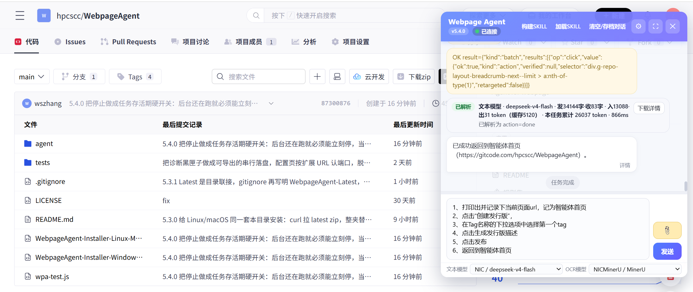

# 网页智能体助手（Webpage Agent）

用大模型操作当前网页：理解页面、填写表单、点击、上传已附加文件。Chrome / Edge 的 MV3 扩展，需要 Chrome 109 或更高版本。

详细的使用手册见 [doc/user-guide-cn.md](doc/user-guide-cn.md)。英文版见 [doc/user-guide.md](doc/user-guide.md)。

## 能做什么

- 点击工具栏图标，在当前页注入聊天面板（须已在目标网站登录）
- 文本模型与 OCR 模型分开配置，用下拉框切换
- 文本附件直接进入上下文；PDF / 图片先识别，再交给文本模型
- 根据页面快照执行白名单操作，不运行任意脚本
- 配置可导入导出；任务可存为可复用技能



**图1. 六句指令完成发布软件流程自动化**

## 安装

**Windows（推荐）** 打开 [安装脚本页面](https://gitcode.com/hpcscc/WebpageAgent/blob/main/WebpageAgent-Installer-Windows.bat)，点击页面上的「下载」，把 `WebpageAgent-Installer-Windows.bat` 存到希望安装插件的目录（保存时核对文件名和 `.bat` 后缀，不要变成 `.txt`）。然后双击运行。

Chrome 等浏览器常会拦截这次下载：`.bat` 属于可执行脚本，Safe Browsing 会把它当成「危险文件类型」，并不是脚本本身已被判定为病毒。若地址栏或下载托盘提示已拦截，打开完整下载列表（Chrome 地址栏输入 `chrome://downloads/`，Edge 为 `edge://downloads/`），找到这一行，在可操作选项里选「忽略危险」或「仍然下载 / 保留」。

也可直接打开 [raw 文件](https://raw.gitcode.com/hpcscc/WebpageAgent/raw/main/WebpageAgent-Installer-Windows.bat)（下载器仍可能拦截，但便于复制脚本内容）：

`https://raw.gitcode.com/hpcscc/WebpageAgent/raw/main/WebpageAgent-Installer-Windows.bat`

或在 PowerShell 中下载并运行同一文件：

```powershell
iwr -useb https://raw.gitcode.com/hpcscc/WebpageAgent/raw/main/WebpageAgent-Installer-Windows.bat -OutFile WebpageAgent-Installer-Windows.bat; .\WebpageAgent-Installer-Windows.bat
```

脚本会把压缩包解压到自身所在目录，并创建 `WebpageAgent-Latest` 目录联接。请加载其中的 **`agent` 子目录**（推荐 Latest 那条）。然后在弹出的扩展页面打开「开发人员模式」，选择「加载解压缩的扩展」。

**Linux / macOS**：可下载 [安装脚本](https://gitcode.com/hpcscc/WebpageAgent/blob/main/WebpageAgent-Installer-Linux-Mac.sh) 到希望安装插件的目录，然后执行：

```bash
chmod +x WebpageAgent-Installer-Linux-Mac.sh && ./WebpageAgent-Installer-Linux-Mac.sh
```

[raw 文件](https://raw.gitcode.com/hpcscc/WebpageAgent/raw/main/WebpageAgent-Installer-Linux-Mac.sh) 便于复制：

`https://raw.gitcode.com/hpcscc/WebpageAgent/raw/main/WebpageAgent-Installer-Linux-Mac.sh`

也可自行下载发行版压缩包，手动解压后，在 Chrome / Edge 中打开开发人员模式，加载其中的 **`agent` 目录**。

**手动**：从 Release 解压，或 clone 本仓库后，在 Chrome / Edge 的扩展页打开开发人员模式，加载 **`agent` 目录**（不是仓库根）。安装脚本给出的两条路径都可用：`WebpageAgent-Latest\agent`（推荐）与 `解压文件夹\agent`。直接 clone 时加载仓库里的 `agent`。

## 使用前提

- 自备 OpenAI 兼容的文本模型接口
- OCR 按设置页中的类型配置
- 先登录目标网站，再点击工具栏图标

## 使用说明

详细的使用手册见 [doc/user-guide-cn.md](doc/user-guide-cn.md)：如何编写任务指令，以及模型可调用的全部工具、参数与分支。

## 免责声明

本扩展免费、无需授权。使用风险由用户自负：不保证不会搞崩业务。不建议新手做无人看守的自动化，也不建议用管理员账号做自动化。可设置自动化操作步骤数量上限，并构建固定、经过验证的 WEB-SKILL，以降低风险。

## 许可证

GNU AGPL-3.0，详见 [LICENSE](LICENSE)。
