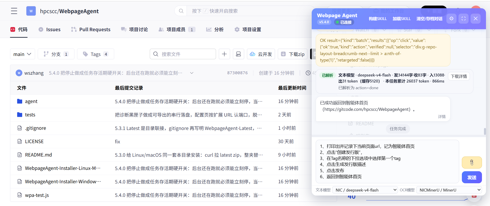

# Webpage Agent

Use a large language model to operate the current web page: understand the page, fill forms, click controls, and upload attached files. An MV3 extension for Chrome / Edge 121+ and Firefox 128+.

Full user guide: [doc/user-guide.md](doc/user-guide.md). Chinese edition: [doc/user-guide-cn.md](doc/user-guide-cn.md).

## What it does

- Click the toolbar icon to inject a chat panel on the current tab (you must already be logged in on the target site)
- Configure text and OCR models separately; switch models from a dropdown
- Pick attachments from disk or WebDAV. After pasting an image you can keep typing and adding files; on send, every attachment is processed first, then the instruction runs. The model reads attachment text on demand with `get`
- Runs whitelist operations from page snapshots; does not execute arbitrary scripts. Controls inside cross-origin iframes can be read and written too
- Choose the page operation mode: Chrome DevTools Protocol, WebDriver BiDi, the built-in DOM event protocol, or auto by browser
- Keys, drag and drop, and native dialogs (alert / confirm / prompt)
- Export a full trace (JSONL) for each task; the repo ships a local evaluation harness in `eval/`
- Import and export settings (including WebDAV); save successful tasks as reusable WEB-SKILLS



**Figure 1. Six prompts automating a software release workflow**

## Installation

**Windows (recommended)** Open the [installer script page](https://gitcode.com/hpcscc/WebpageAgent/blob/main/WebpageAgent-Installer-Windows.bat), click **Download**, and save `WebpageAgent-Installer-Windows.bat` to the folder where you want the extension (verify the `.bat` extension; do not save as `.txt`). Double-click to run.

Browsers often block this download: `.bat` is an executable script type, and Safe Browsing flags it as a risky file type—not necessarily because the script is malicious. If the download is blocked, open the full downloads list (`chrome://downloads/` in Chrome, `edge://downloads/` in Edge), find the entry, and choose **Keep** or **Download anyway**.

You can also open the [raw file](https://raw.gitcode.com/hpcscc/WebpageAgent/raw/main/WebpageAgent-Installer-Windows.bat) (may still be blocked, but easy to copy):

`https://raw.gitcode.com/hpcscc/WebpageAgent/raw/main/WebpageAgent-Installer-Windows.bat`

Or download and run in PowerShell:

```powershell
iwr -useb https://raw.gitcode.com/hpcscc/WebpageAgent/raw/main/WebpageAgent-Installer-Windows.bat -OutFile WebpageAgent-Installer-Windows.bat; .\WebpageAgent-Installer-Windows.bat
```

The script unpacks the archive next to itself and creates a `WebpageAgent-Latest` directory junction. Load the **`agent` subdirectory** (the Latest path is recommended). On the extensions page, enable **Developer mode**, then **Load unpacked**.

**Linux / macOS** Download the [installer script](https://gitcode.com/hpcscc/WebpageAgent/blob/main/WebpageAgent-Installer-Linux-Mac.sh) into your chosen folder, then run:

```bash
chmod +x WebpageAgent-Installer-Linux-Mac.sh && ./WebpageAgent-Installer-Linux-Mac.sh
```

[Raw file](https://raw.gitcode.com/hpcscc/WebpageAgent/raw/main/WebpageAgent-Installer-Linux-Mac.sh):

`https://raw.gitcode.com/hpcscc/WebpageAgent/raw/main/WebpageAgent-Installer-Linux-Mac.sh`

You may also download a release archive, unpack it, enable Developer mode in Chrome / Edge, and load the **`agent` directory**.

**Manual** Unpack a release or clone this repo, enable Developer mode, and load the **`agent` directory** (not the repo root). Installer paths: `WebpageAgent-Latest\agent` (recommended) or `unpacked-folder\agent`. When cloning, load `agent` inside the repo.

**Firefox** Open `about:debugging#/runtime/this-firefox`, click **Load Temporary Add-on…**, and pick `agent/manifest.json`. A temporary add-on is removed when Firefox closes; load it again next time.

## Page operation mode

**Page operation mode** on the global settings page decides what performs clicks, typing, keys, drags and native dialogs:

| Option | Browsers | Notes |
| --- | --- | --- |
| auto (default) | all | Chromium-based browsers use Chrome DevTools Protocol, Firefox uses WebDriver BiDi, other browsers use the built-in DOM event protocol. The mode actually picked is shown next to the option |
| Chrome DevTools Protocol | Chrome / Edge | Trusted input from the browser. While a task runs, the tab shows a "started debugging this browser" bar |
| WebDriver BiDi W3C Standard Protocol | Firefox | Trusted input from the browser. Firefox must be started with flags, see below |
| Built-in DOM event protocol | all | Synthetic events dispatched inside the page. Receipts carry `trusted: false`; browser default actions for keys (moving focus, typing characters) do not happen, and native dialogs are not supported |

If the chosen mode cannot connect, the task reports an error and does not switch to another mode.

To use WebDriver BiDi, start Firefox with the Remote Agent enabled and allow the extension to connect:

```bash
firefox --remote-debugging-port=9222 --remote-allow-origins=moz-extension://<extension UUID>
```

The settings page shows the exact flags including the UUID (also listed as "Internal UUID" in `about:debugging`). The port is configurable, and **Test connection** checks the link. Any local program can connect to this port while it is open.

## Prerequisites

- Your own OpenAI-compatible text model API
- OCR configured per the settings page
- Log in on the target site before opening the panel

## User guide

See [doc/user-guide.md](doc/user-guide.md) for how to write task instructions and for all public tools, parameters, and branches the model can call.

## Task traces and the evaluation harness

- **Record task traces** is on by default in global settings. A trace holds the full request sent to the model at every step, the raw reply, page receipts and timings, and stays on this machine. After a task, click **Download trace** in the panel to export JSONL.
- `eval/` is a local evaluation harness: fixture pages (native form, Element Plus, Ant Design, cross-origin iframe, closed shadow root, virtual list, drag sort, keyboard-only widget, native dialogs, upload and download, and more), judged by checking the submitted form on the server side.

```bash
cd eval && npm install
node setup-browsers.mjs     # downloads Chromium and Firefox into eval/browsers/, which is not committed
node run-chromium.mjs       # runs dom, then cdp
node run-firefox.mjs        # runs dom, then bidi
```

Browsers live in `eval/browsers/`. `CHROMIUM_PATH` and `FIREFOX_BIN` can still point at other executables. The Firefox runner writes `policies.json` under that Firefox's `distribution/` directory. Reports go to `eval/out/<time>-<browser>/<mode>/report.md`, which is also not committed.

Op-level tasks (`tasks/ops.json`) need no model. Model tasks (`tasks/model.json`) read `eval/model.env`: copy `eval/model.env.example` to `eval/model.env` and fill in `WPA_EVAL_BASE_URL`, `WPA_EVAL_API_KEY` and `WPA_EVAL_MODEL` (OCR via optional `WPA_EVAL_OCR_*`). `model.env` is listed in `.gitignore`. An environment variable with the same name overrides the file. If any of the three is missing, model tasks are reported as skipped.

## Disclaimer

This extension is free and unlicensed for use. You assume all risk; it may break production workflows. Unattended automation is not recommended for beginners; avoid admin accounts for automation. Set a step limit and use fixed, verified WEB-SKILLS to reduce risk.

## License

GNU AGPL-3.0. See [LICENSE](LICENSE).
